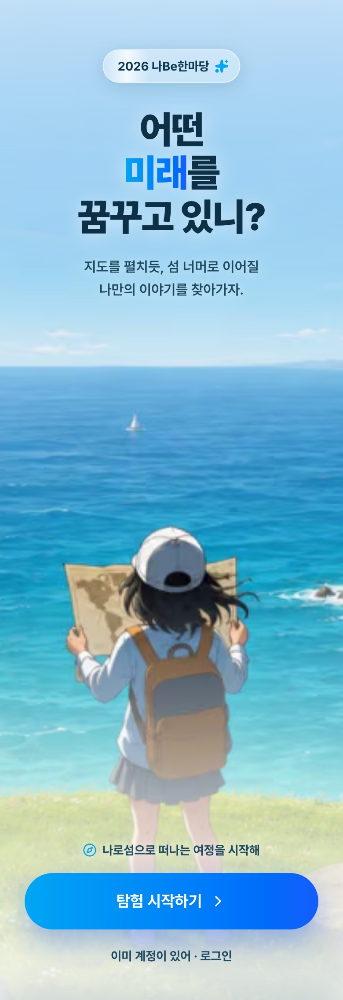
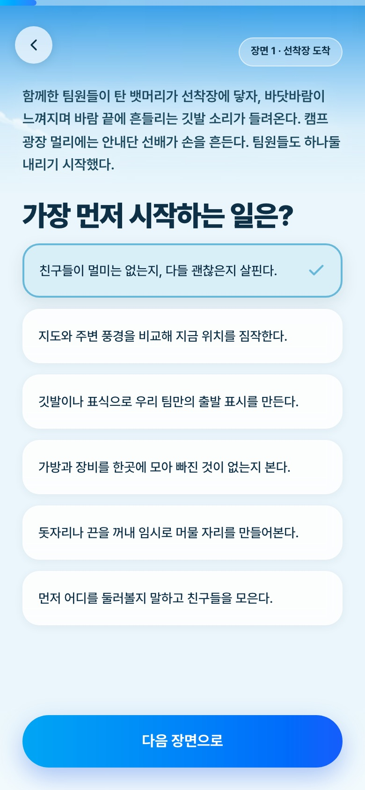
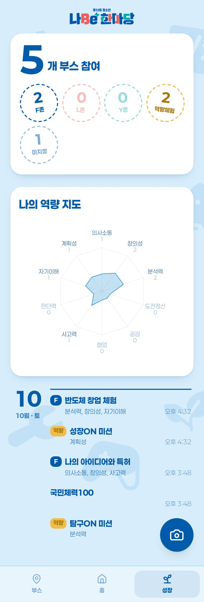

# 나Be한마당 — AI 페르소나 카드 진로 탐색

> **진로는 정답을 찾는 시험이 아니라, 나를 써 내려가는 서사다.**

2026 나Be한마당 진로박람회에서 운영한 참여형 진로 탐색 서비스.
학생이 몇 가지 질문에 답하면 AI가 관심사와 성향을 해석해 **미래 페르소나(직업) 카드**를
만들어 준다. 학생은 이 카드를 들고 행사장 체험부스를 돌며 QR로 방문을 인증하고,
그 기록을 개인 페이지에 쌓아 간다.

> 행사가 끝나 운영을 종료한 저장소다. 코드와 문서는 기록용으로 남겨 둔다.

## 화면

<table>
  <tr>
    <td align="center"></td>
    <td align="center"></td>
    <td align="center"></td>
    <td align="center"></td>
    <td align="center"></td>
  </tr>
  <tr>
    <td align="center">웰컴</td>
    <td align="center">탐험 설문</td>
    <td align="center">페르소나 카드</td>
    <td align="center">카드 뒷면 (나비 그림)</td>
    <td align="center">성장 · 역량 지도</td>
  </tr>
</table>

화면 사진은 테스트 계정으로 찍었다. 전체 화면은 스토리보드 페이지(`/dev/storyboard`)에서
흐름별로 볼 수 있다(원본: [`frontend/public/storyboard/`](frontend/public/storyboard/)).

## 학생 흐름

```
가입·로그인 → 탐험 설문: 고정 질문 6개(낮) → AI 생성 질문 3개(밤)
          → 사진 등록 → 페르소나 카드 발급
          → 부스 · 홈 · 성장 탭
                 └─ 부스 QR 스캔 → 방문 인증 → 성장 탭의 역량 지도에 반영
```

- **홈**: 내 페르소나 카드. 뒤집으면 부스 체험 결과로 그린 나비 그림이 나온다.
- **부스**: 행사장 배치도와 나에게 어울리는 체험 추천.
- **성장**: 참여한 부스 수와 역량 10개 레이더 차트, 방문 기록.
- 카드는 공개 링크(`/p/[code]`)로 다른 사람에게 보여줄 수 있다.

운영진 콘솔(`/operator`)과 관리자 콘솔(`/admin`)에서 좌석표·부스·방문·회원을 관리한다.

## 시스템 구조

```
 학생 · 운영진 · 관리자 (모바일/PC 브라우저)
        │ HTTPS
        ▼
 Vercel — Next.js 16 (App Router)
        │ fetch (JWT)
        ▼
 AWS Lightsail — Caddy(자동 HTTPS) → FastAPI 컨테이너
        │   Router → Service → Repository / Adapter
        │   + 카드 자동 공개 워커 (인-프로세스, DB 폴링)
        │
        ├──▶ Supabase Postgres   계정·설문·페르소나·카드·부스 방문
        ├──▶ AWS S3 (비공개)     원본 사진·AI 인물·카드 이미지
        ├──▶ OpenRouter          질문 생성·페르소나 해석 (LLM)
        ├──▶ Vertex AI (Gemini)  10년 뒤 내 모습 이미지
        └──▶ 나비(페인트팜) API   카드 뒷면 그림
                    │
 브라우저 ◀── presigned URL로 S3 이미지를 직접 조회 (서버 미경유)
```

원칙은 **무거운 일은 위임한다**: 연산은 AI API, 데이터는 Supabase, 파일은 S3가 맡고
Lightsail 서버는 이들을 엮는 일만 한다. 그래서 작은 인스턴스 하나로 운영했다.

### 구성 요소

| 영역 | 기술 | 역할 |
|---|---|---|
| 프론트엔드 | Next.js 16 · TypeScript · Tailwind 4 · shadcn/ui · Zustand · Framer Motion | 학생 화면, 운영진·관리자 콘솔. Vercel 배포 |
| 백엔드 | Python · FastAPI · asyncpg · uv | REST API + 카드 생성 워커. Docker + Caddy |
| DB | Supabase Postgres | 스키마 3개로 권한 격리 — `pii`(학생 원본) · `generated`(설문·페르소나·카드) · `ops`(부스·방문·설정) |
| 파일 | AWS S3 | `uploads/` 원본 사진 · `ai-images/` AI 인물 · `cards/` 최종 카드. presigned URL로만 노출 |
| AI | OpenRouter · Vertex AI | 목적(purpose)별로 호출하고 모델 매핑은 환경변수로 분리 |
| 인증 | JWT | 학생·운영진·관리자 토큰 분리, 조회는 운영진도·쓰기는 관리자만 |
| CI/CD | GitHub Actions | `production`에 `backend/**` push → 테스트 → SSH 배포 |

### 카드가 만들어지는 과정

```
설문 완료 + 사진 업로드
      │  워커가 DB를 폴링해 대상 선정 (별도 큐 없음)
      ▼
 페르소나 문구 (OpenRouter, JSON 스키마)  ∥  10년 뒤 사진 (Vertex)
      │
      ▼
 카드 합성 → S3 저장 → DB 기록 → 학생 홈에 공개
```

- 사진이 부적합(얼굴 없음 등)하면 **폴백 캐릭터 카드**로 공개한다.
- 429·5xx 같은 일시적 실패는 저장하지 않고 다음 폴링에서 다시 시도한다.
- 관리자 검수 화면(`/admin/review`)에서 문구를 고치거나 다시 공개할 수 있다.

### 백엔드 레이어

```
Router      HTTP 진입점 · 입력 검증 · 인증 가드
Service     비즈니스 규칙 · 트랜잭션
Repository  DB 쿼리
Adapter     외부 시스템 — OpenRouter · S3 · DB 풀 · JWT
```

### 저장소 구성

| 디렉터리 | 설명 |
|---|---|
| [`backend/`](backend/) | API 서버 — `app/routers`·`services`·`repositories`·`adapters`, `supabase/migrations`, `tests` |
| [`frontend/`](frontend/) | 학생·운영진·관리자 UI — `app/`(라우트), `components/`, `store/`, `lib/` |
| [`docs/`](docs/) | 가이드·이슈 기록·분석 문서 |

더 자세한 내용(상태 머신, 인증, 개인정보, 부하 전략)은 [아키텍처 문서](docs/guides/architecture.md)를 본다.

## 로컬 실행

외부 서비스(Supabase·S3·OpenRouter) 키가 필요하다. 예시 파일을 복사해 값을 채운다.

```bash
# 백엔드 — http://localhost:8000/docs
cd backend && cp .env.example .env && uv sync
uv run uvicorn app.main:app --reload

# 프론트엔드 — http://localhost:4000
cd frontend && cp .env.local.example .env.local && npm install
npm run dev
```

자세한 내용은 [개발 가이드](docs/guides/development.md).

## 문서

[`docs/README.md`](docs/README.md)가 전체 지도다.

| 문서 | 내용 |
|---|---|
| [아키텍처](docs/guides/architecture.md) | 시스템 구조·데이터 저장·상태 머신 |
| [배포](docs/guides/deployment.md) | 배포·CD·운영 환경변수·DB 마이그레이션 |
| [운영 런북](docs/guides/operations.md) | 행사 중 장애 대응 |
| [이슈 기록](docs/issues/README.md) | 개발 중 삽질과 인프라 판단 |
| [프로젝트 비전](docs/notes/2026-03-19-프로젝트-비전.md) | 왜 이 프로젝트를 시작했는가 |

## 히스토리

원래 `backend`·`frontend`·`docs` 3개 저장소였고, 2026-07-01에 커밋 히스토리를
보존한 채(`git filter-repo`) 하나로 합쳤다. 특정 파일 이력은 `git log --follow -- <path>`.
